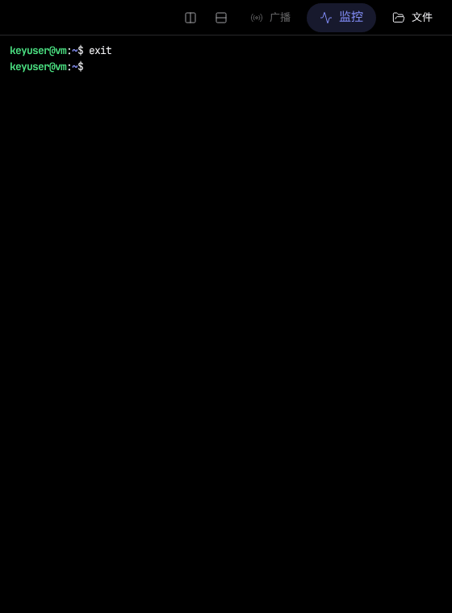
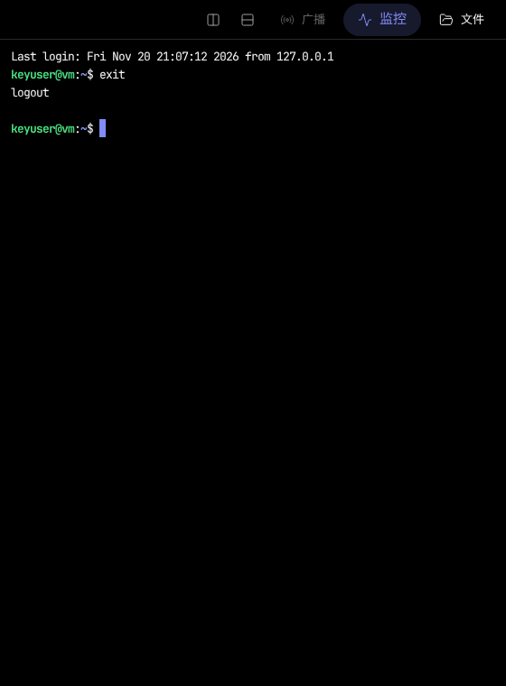

# 终端实测对齐矩阵（2026-11-20）

上一轮"对齐主流 SSH 客户端"是对着清单读代码补功能，没有人真的去用。这一轮换成**以实际使用为验收标准**：用真实的
OpenSSH 服务器、真实的会话守护进程和内置 SSH 引擎、应用自己的前端，在 Chromium（与 Windows 上的 WebView2 同内核）里像人一样按键、点击、拖动、滚动，逐项对照 Windows Terminal、iTerm2、WezTerm、Termius、MobaXterm/FinalShell 的行为。

- 测试脚本：[`scripts/terminal-e2e.mjs`](../scripts/terminal-e2e.mjs)（每项一个检查，失败就让 CI 变红）
- 会话桥：[`crates/easyssh-e2e/examples/web_bridge.rs`](../crates/easyssh-e2e/examples/web_bridge.rs)，把浏览器里的终端接到真实守护进程（内置引擎）和 `e2e/` 的 sshd 容器
- CI：任务 **Terminal end-to-end (Linux)**，除纯文档改动外每个 PR 都跑，截图和报告在 `ci-results/<分支>` 的 `logs-terminal-e2e/`
- 按 Windows 用户的按键习惯跑（`PLATFORM=win`，用户的主力平台）；macOS 的 ⌘ 键行为 Chromium 模拟不出来，仍需真机

## 结果

| | 通过 |
|---|---|
| 修复前（main @ e81886d，已含 #109 右键菜单、#112 OSC 8） | **25 / 36** |
| 修复后（本 PR） | **36 / 36** |

## 终端矩阵

✅ 一致　🔧 本 PR 修复　➖ 有意不同（说明原因）　🔀 属于其他线程

| 方面 | 检查 | 主流终端的行为 | 修复前 | 现在 |
|---|---|---|---|---|
| 连接 | `connect` | 打开主机即得到远端提示符，TERM 与 UTF-8 的 LANG 正确（服务器按 Debian/Ubuntu 默认只接收 LANG、LC_*，真彩色由 XTGETTCAP 告知） | ✅ | ✅ `TERM=xterm-256color LANG=C.UTF-8` |
| 显示 | `cjk-emoji-width` | 中文、emoji 各占两格，光标对齐 | ✅ | ✅ |
| 显示 | `truecolor` | 24 位真彩色按原色显示 | ✅ | ✅ |
| 显示 | `ansi-black-contrast` | ANSI 黑色是深色；htop 表头、F1–F10 键名、tmux 状态栏这类"彩色底黑字"清楚可读 | ❌ 深色主题里黑色被映射成灰色 `#8E8E93`，彩色底上对比度 1.6:1，htop 底栏的 Help/Setup… 和表头几乎看不见 | 🔧 黑色改为 `--bg-elevated`（#1C1C1E），并加 VS Code 同款"最低对比度 4.5:1"保护；最差 8.3:1 |
| 窗口 | `sidebar-toggle` | 侧栏可收起，终端占满窗口（Termius、MobaXterm、VS Code） | ❌ 无法收起；1200 px 窗口终端只有 76 列，900 px 只剩 33 列 | 🔧 再点一次当前侧栏图标或 Ctrl+B（终端外；macOS ⌃⌘S，按品牌键盘规范）收起，记住选择；76 → 117 列 |
| 复制粘贴 | `copy-shortcut` | 选中后 Ctrl+Shift+C（⌘C）复制 | ✅ | ✅ |
| 复制粘贴 | `ctrl-c-copies-selection` | Windows Terminal：有选中时 Ctrl+C 复制，没有时是 ^C | ❌ Ctrl+C 一律发 ^C，选中的文字复制不了 | 🔧 新设置"Ctrl+C 复制、Ctrl+V 粘贴"，Windows 默认开、Linux 默认关、macOS 不显示 |
| 复制粘贴 | `ctrl-v-pastes` | Windows Terminal：Ctrl+V 粘贴 | ❌ Ctrl+V 发 ^V | 🔧 同上 |
| 复制粘贴 | `multiline-paste` | shell 开括号粘贴时多行不执行，否则先确认 | ✅ | ✅ |
| 复制粘贴 | `osc52` | tmux/vim 用 OSC 52 写本机剪贴板 | ✅ | ✅ |
| 复制粘贴 | `right-click-menu` | 右键是应用菜单，不是浏览器菜单 | ✅（#109） | ✅ 复制、粘贴、全选、查找、清屏 |
| 选择 | `triple-click-line` | 三击选整行 | ✅ | ✅ |
| 选择 | `shift-click-extend` | Shift+单击扩展选区 | ✅ | ✅ |
| 选择 | `select-in-mouse-app` | 程序开了鼠标时 Shift+拖动仍能选字 | ✅ | ✅（TUI 内鼠标点击本身 🔀「修复 btop 等程序的鼠标点击」） |
| 滚动 | `wheel-scrollback` | 滚轮翻历史 | ✅ | ✅ |
| 滚动 | `shift-pageup` | Shift+PageUp/PageDown 翻页 | ✅ | ✅ |
| 滚动 | `wheel-in-less` | less/man 里滚轮翻页 | ✅ | ✅ |
| 搜索 | `find` | Ctrl+Shift+F 查找、显示匹配数、回车下一个 | ✅ | ✅ |
| 链接 | `url-click` | Ctrl+单击 URL 用系统浏览器打开 | ✅ | ✅ |
| 链接 | `osc8-hyperlink` | OSC 8 超链接 Ctrl+单击打开，不弹确认框 | ✅（#112） | ✅ |
| 标题 | `title` | 远端 OSC 0/2 标题可见 | ➖ | ➖ 标签显示主机名，远端标题在悬停提示里（同 Termius；Windows Terminal 直接用标题当标签名）。SSH 客户端里主机名更重要，保留 |
| 输入 | `ime-insert` | 输入法上屏的中文直接进入远端 | ✅ | ✅ |
| 输入 | `keys` | Home/End、Ctrl+←/→ 按词移动、Alt+. 取上一个参数 | ✅ | ✅ |
| 全屏程序 | `vim` | 备用屏、退出后恢复原屏 | ✅ | ✅ |
| 全屏程序 | `tmux` | 状态栏、Ctrl+B % 分屏 | ✅（状态栏文字看不清，见对比度一项） | ✅ |
| 全屏程序 | `htop` | 正确绘制 | ✅（底栏文字看不清，见对比度一项） | ✅ |
| 窗口 | `resize` | 窗口变化后 `stty size` 跟着变 | ✅ | ✅ |
| 字体 | `zoom` | Ctrl+= / Ctrl+- / Ctrl+0（⌘）缩放、复位 | ❌ 没有 | 🔧 只作用于当前窗格，复位回到设置里的字号；Ctrl+Shift+-（readline 撤销）仍归 shell |
| 字体 | `ctrl-wheel-zoom` | Ctrl+滚轮缩放 | ❌ 没有（#109 只拦掉了网页缩放） | 🔧 |
| 标签与分屏 | `split` | 分屏后新窗格也连上 | ✅ | ✅ |
| 标签与分屏 | `tab-switch` | Ctrl+Tab / Ctrl+Shift+Tab 切换标签 | ❌ 没有 | 🔧 另有 macOS ⌘⇧] / ⌘⇧[；已写进快捷键列表 |
| 标签与分屏 | `duplicate-tab` | 标签右键"复制标签" | ❌ 没有；而且单击主机只会跳到已开的标签，同一主机想开第二个会话只能分屏 | 🔧 |
| 标签与分屏 | `open-host-new-tab` | 同一主机再开一个标签 | ❌ 同上 | 🔧 主机右键"在新标签中打开" |
| 标签与分屏 | `tab-drag` | 拖动标签排序 | ❌ 拖不动 | 🔧 |
| 会话 | `exit-reconnect` | 结束后显示原因，回车重连，新会话接在旧输出下面 | ❌ 重连后新会话从屏幕左上角开始覆盖旧内容（每次自动重连也一样） | 🔧 重连前的复位序列先保存光标（DECSC）；单测用真实 xterm 解析器验证 |
| 性能 | `bulk-output` | 20 万行输出不卡 | ✅ | ✅ 0.8 秒 |

### 修复前后

htop（修复前：表头和底栏 F1–F10 后面的字看不清）：

| 修复前 | 修复后 |
|---|---|
|  |  |

`exit` 后回车重连（修复前：新会话盖在旧屏幕上，"logout" 那一行被覆盖）：

| 修复前 | 修复后 |
|---|---|
|  |  |

收起侧栏后终端占满宽度：


## 其他方面

这些不经过终端界面，已有对真实 sshd 容器的 Rust 端到端测试（`crates/easyssh-e2e/tests/`，CI 任务 End-to-end (Linux)，两种引擎都跑）：

| 方面 | 主流行为 | 状态 | 依据 |
|---|---|---|---|
| 会话保活 | 关窗口/重载后会话还在，回来能接上并看到之前的输出（tmux 式） | ✅ 超出 Termius（它不保留） | `daemon::daemon_session_survives_a_client_and_replays` |
| 认证 | 公钥、密码、键盘交互、agent、口令保护的密钥、密码回落 | ✅ | `russh_password`、`russh_keys`、`password` |
| 主机密钥 | 首次信任、改变时阻断、哈希 known_hosts、按端口区分 | ✅ | `russh_hostkey` |
| 跳板机 | ProxyJump、链中任一跳被拒即停 | ✅ | `russh_jump`、`daemon::terminal_through_a_jump_host` |
| 代理 | SOCKS5（不本地解析）、HTTP CONNECT | ✅ | `russh_proxy` |
| SFTP | 浏览、上传下载、递归删除、chmod、重命名移动、不存在路径的报错 | ✅ | `russh_sftp`、`sftp` |
| 端口转发 | -L、-D（SOCKS4a/5，IPv4/6）、-R、Unix socket、端口占用快速失败、多个转发共用一条连接 | ✅ | `russh_tunnels`、`tunnels` |
| 文件面板界面 | 拖放、队列、进度 | 未在本测试里（文件面板的浏览器端仍是预览数据） | 下一步：把 `sftp_*` 也接进会话桥 |
| 设置页窄窗口排版 | 文字不竖排、不溢出 | 🔀 | 线程「全面排查并杜绝 UI 布局问题」 |
| TUI 里的鼠标点击（btop、htop、mc） | 点击、滚轮发给程序 | 🔀 | 线程「修复 btop 等程序的鼠标点击」 |

## 还没对齐的

- **连字（ligatures）**：Windows Terminal、WezTerm、iTerm2 支持 Fira Code/Cascadia 的连字；xterm.js 在 WebView 里需要额外插件且只对部分字体有效，暂未做。
- **标签重命名**：Windows Terminal、iTerm2 可以给标签改名；本 PR 未做。
- **macOS 按键**：⌘C/⌘V 依赖 WKWebView 的系统菜单，Chromium 里模拟不出来，需要在 Mac 上手测（RELEASING.md 冒烟测试）。
- **窄窗口下监控栏占宽**：修复前 900 px 窗口里终端只剩 33 列；#113 起窄窗口自动把监控栏折成窄条（现在 67 列），再收起侧栏可更宽。

## 怎么在本地跑

```sh
e2e/prepare.sh && docker compose -f e2e/docker-compose.yml up -d --build && e2e/wait-ready.sh
cargo build -p easyssh-e2e --example web_bridge
npm run build && (npm run preview &)
node scripts/terminal-e2e.mjs http://localhost:4173 terminal-e2e      # ONLY=zoom,tab-drag 只跑几项
```

每项都会在输出目录留一张截图，`report.md` 是这张表的"结果"列。
