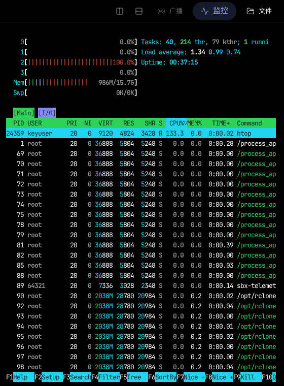
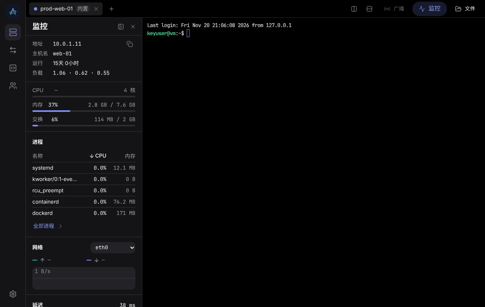
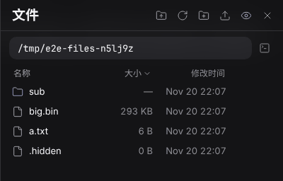
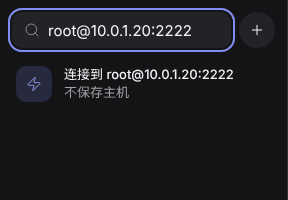
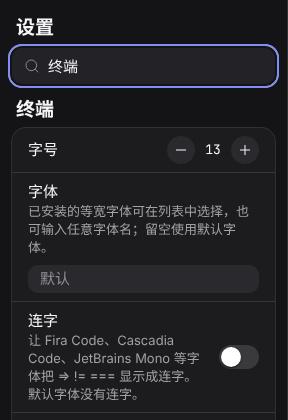
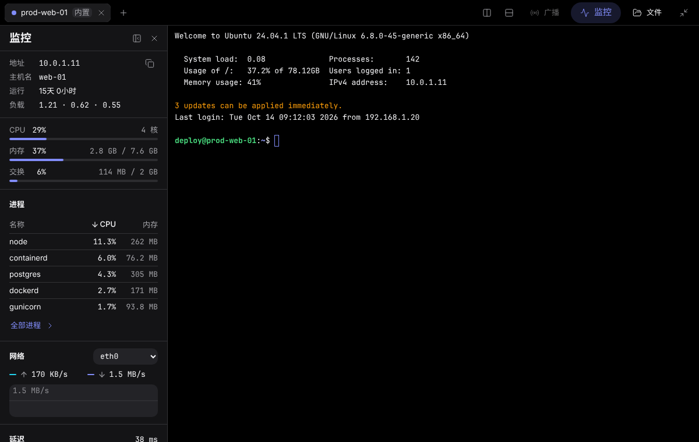

# 实测对齐矩阵：终端、文件、连接、转发、设置（2026-11-20）

上一轮"对齐主流 SSH 客户端"是对着清单读代码补功能，没有人真的去用。这一轮换成**以实际使用为验收标准**：用真实的
OpenSSH 服务器、真实的会话守护进程和内置 SSH 引擎、应用自己的前端，在 Chromium（与 Windows 上的 WebView2 同内核）里像人一样按键、点击、拖动、滚动，逐项对照 Windows Terminal、iTerm2、WezTerm、Termius、MobaXterm/FinalShell 的行为。

- 测试脚本：[`scripts/terminal-e2e.mjs`](../scripts/terminal-e2e.mjs)（每项一个检查，失败就让 CI 变红）
- 会话桥：[`crates/easyssh-e2e/examples/web_bridge.rs`](../crates/easyssh-e2e/examples/web_bridge.rs)，把浏览器里的终端、文件面板（SFTP 与传输队列）和端口转发接到真实守护进程（内置引擎）和 `e2e/` 的 sshd 容器
- CI：任务 **Terminal end-to-end (Linux)**，除纯文档改动外每个 PR 都跑，截图和报告在 `ci-results/<分支>` 的 `logs-terminal-e2e/`
- 按 Windows 用户的按键习惯跑（`PLATFORM=win`，用户的主力平台）；macOS 的 ⌘ 键行为 Chromium 模拟不出来，仍需真机

## 结果

| | 通过 |
|---|---|
| 修复前（main @ e81886d，已含 #109 右键菜单、#112 OSC 8） | **25 / 36** |
| 修复后（#114） | **36 / 36** |
| 加上连字、标签重命名 | **38 / 38** |
| 第二轮：文件面板、连接管理、端口转发、设置（24 项），修复前 | **12 / 24** |
| 第二轮修复后（全部 62 项） | **62 / 62** |
| 加上二进制文件双击、专注模式（全部 64 项） | **64 / 64** |

## 终端矩阵

✅ 一致　🔧 本 PR 修复　➖ 有意不同（说明原因）　🔀 属于其他线程

| 方面 | 检查 | 主流终端的行为 | 修复前 | 现在 |
|---|---|---|---|---|
| 连接 | `connect` | 打开主机即得到远端提示符，TERM 与 UTF-8 的 LANG 正确（服务器按 Debian/Ubuntu 默认只接收 LANG、LC_*，真彩色由 XTGETTCAP 告知） | ✅ | ✅ `TERM=xterm-256color LANG=C.UTF-8` |
| 显示 | `cjk-emoji-width` | 中文、emoji 各占两格，光标对齐 | ✅ | ✅ |
| 显示 | `truecolor` | 24 位真彩色按原色显示 | ✅ | ✅ |
| 显示 | `ansi-black-contrast` | ANSI 黑色是深色；htop 表头、F1–F10 键名、tmux 状态栏这类"彩色底黑字"清楚可读 | ❌ 深色主题里黑色被映射成灰色 `#8E8E93`，彩色底上对比度 1.6:1，htop 底栏的 Help/Setup… 和表头几乎看不见 | 🔧 黑色改为 `--bg-elevated`（#1C1C1E），并加 VS Code 同款"最低对比度 4.5:1"保护；最差 8.3:1 |
| 窗口 | `sidebar-toggle` | 侧栏可收起，终端占满窗口（Termius、MobaXterm、VS Code） | ❌ 无法收起；1200 px 窗口终端只有 76 列，900 px 只剩 33 列 | 🔧 再点一次当前侧栏图标或 Ctrl+B（终端外；macOS ⌃⌘S，按品牌键盘规范）收起，记住选择；76 → 117 列 |
| 复制粘贴 | `copy-shortcut` | 选中后 Ctrl+Shift+C（⌘C）复制 | ✅ | ✅ |
| 复制粘贴 | `ctrl-c-copies-selection` | Windows Terminal：有选中时 Ctrl+C 复制，没有时是 ^C | ❌ Ctrl+C 一律发 ^C，选中的文字复制不了 | 🔧 新设置"Ctrl+C 复制、Ctrl+V 粘贴"，Windows 默认开、Linux 默认关、macOS 不显示 |
| 复制粘贴 | `ctrl-v-pastes` | Windows Terminal：Ctrl+V 粘贴 | ❌ Ctrl+V 发 ^V | 🔧 同上 |
| 复制粘贴 | `multiline-paste` | shell 开括号粘贴时多行不执行，否则先确认 | ✅ | ✅ |
| 复制粘贴 | `osc52` | tmux/vim 用 OSC 52 写本机剪贴板 | ✅ | ✅ |
| 复制粘贴 | `right-click-menu` | 右键是应用菜单，不是浏览器菜单 | ✅（#109） | ✅ 复制、粘贴、全选、查找、清屏 |
| 选择 | `triple-click-line` | 三击选整行 | ✅ | ✅ |
| 选择 | `shift-click-extend` | Shift+单击扩展选区 | ✅ | ✅ |
| 选择 | `select-in-mouse-app` | 程序开了鼠标时 Shift+拖动仍能选字 | ✅ | ✅（TUI 内鼠标点击本身 🔀「修复 btop 等程序的鼠标点击」） |
| 滚动 | `wheel-scrollback` | 滚轮翻历史 | ✅ | ✅ |
| 滚动 | `shift-pageup` | Shift+PageUp/PageDown 翻页 | ✅ | ✅ |
| 滚动 | `wheel-in-less` | less/man 里滚轮翻页 | ✅ | ✅ |
| 搜索 | `find` | Ctrl+Shift+F 查找、显示匹配数、回车下一个 | ✅ | ✅ |
| 链接 | `url-click` | Ctrl+单击 URL 用系统浏览器打开 | ✅ | ✅ |
| 链接 | `osc8-hyperlink` | OSC 8 超链接 Ctrl+单击打开，不弹确认框 | ✅（#112） | ✅ |
| 标题 | `title` | 远端 OSC 0/2 标题可见 | ➖ | ➖ 标签显示主机名，远端标题在悬停提示里（同 Termius；Windows Terminal 直接用标题当标签名）。SSH 客户端里主机名更重要，保留 |
| 输入 | `ime-insert` | 输入法上屏的中文直接进入远端 | ✅ | ✅ |
| 输入 | `keys` | Home/End、Ctrl+←/→ 按词移动、Alt+. 取上一个参数 | ✅ | ✅ |
| 全屏程序 | `vim` | 备用屏、退出后恢复原屏 | ✅ | ✅ |
| 全屏程序 | `tmux` | 状态栏、Ctrl+B % 分屏 | ✅（状态栏文字看不清，见对比度一项） | ✅ |
| 全屏程序 | `htop` | 正确绘制 | ✅（底栏文字看不清，见对比度一项） | ✅ |
| 窗口 | `resize` | 窗口变化后 `stty size` 跟着变 | ✅ | ✅ |
| 字体 | `zoom` | Ctrl+= / Ctrl+- / Ctrl+0（⌘）缩放、复位 | ❌ 没有 | 🔧 只作用于当前窗格，复位回到设置里的字号；Ctrl+Shift+-（readline 撤销）仍归 shell |
| 字体 | `ligatures` | Fira Code、Cascadia Code 等字体的连字（Windows Terminal、WezTerm、iTerm2；Termius 没有） | ❌ 没有 | 🔧 设置 → 终端 → 连字；开启后改用 DOM 渲染（WebGL 逐格绘制，无法连字） |
| 字体 | `ctrl-wheel-zoom` | Ctrl+滚轮缩放 | ❌ 没有（#109 只拦掉了网页缩放） | 🔧 |
| 标签与分屏 | `split` | 分屏后新窗格也连上 | ✅ | ✅ |
| 标签与分屏 | `tab-switch` | Ctrl+Tab / Ctrl+Shift+Tab 切换标签 | ❌ 没有 | 🔧 另有 macOS ⌘⇧] / ⌘⇧[；已写进快捷键列表 |
| 标签与分屏 | `duplicate-tab` | 标签右键"复制标签" | ❌ 没有；而且单击主机只会跳到已开的标签，同一主机想开第二个会话只能分屏 | 🔧 |
| 标签与分屏 | `open-host-new-tab` | 同一主机再开一个标签 | ❌ 同上 | 🔧 主机右键"在新标签中打开" |
| 标签与分屏 | `tab-rename` | 双击或右键给标签改名（Windows Terminal、iTerm2、MobaXterm） | ❌ 没有 | 🔧 回车确认、Esc 取消 |
| 标签与分屏 | `tab-drag` | 拖动标签排序 | ❌ 拖不动 | 🔧 |
| 会话 | `exit-reconnect` | 结束后显示原因，回车重连，新会话接在旧输出下面 | ❌ 重连后新会话从屏幕左上角开始覆盖旧内容（每次自动重连也一样） | 🔧 重连前的复位序列先保存光标（DECSC）；单测用真实 xterm 解析器验证 |
| 会话 | `reconnect-divider` | 重连后明确标出这是新的 shell（之前运行的程序已结束） | ❌ 重连后没有任何提示，看不出是新 shell | 🔧 淡色分隔线，含本地时间；只写进终端，不发给主机，首次连接没有 |
| 会话 | `keep-session-tmux` | 保留会话：重连回到同一个 tmux/screen 屏幕（手机端已有） | ❌ 桌面端没有这个设置 | 🔧 主机编辑里"保留会话"：关闭 / tmux / screen；主机上没有时给出提示并保持普通 shell |
| 性能 | `bulk-output` | 20 万行输出不卡 | ✅ | ✅ 0.8 秒 |

### 修复前后

htop（修复前：表头和底栏 F1–F10 后面的字看不清）：

| 修复前 | 修复后 |
|---|---|
|  |  |

`exit` 后回车重连（修复前：新会话盖在旧屏幕上，"logout" 那一行被覆盖）：

| 修复前 | 修复后 |
|---|---|
|  |  |

收起侧栏后终端占满宽度：



## 文件面板、连接管理、端口转发、设置（第二轮）

同样的办法：文件面板走真实 SFTP 和传输队列，端口转发由守护进程真的监听端口，测试从本机连进去读到服务器上 sshd 的 banner。对照 Termius、FinalShell、MobaXterm（文件面板也参考 WinSCP）。

| 方面 | 检查 | 主流客户端 | 修复前 | 现在 |
|---|---|---|---|---|
| 文件 | `sftp-browse` | 列出远端目录，文件夹在前，显示大小、时间 | ✅ | ✅ |
| 文件 | `sftp-navigate` | 双击进入、上级目录按钮、**Backspace 返回上级**（FinalShell、MobaXterm、WinSCP、资源管理器） | ❌ Backspace 无效 | 🔧 Backspace、Alt+↑（Mac ⌘↑）返回上级并选中刚才的文件夹 |
| 文件 | `sftp-upload` | 上传到当前目录，完成后列表刷新，内容一致 | ✅ md5 一致 | ✅ |
| 文件 | `sftp-download` | 下载到“下载”文件夹，传输列表显示进度和完成 | ✅ | ✅ |
| 文件 | `sftp-mkdir-rename-delete` | 新建文件夹、F2 重命名、Delete 删除（带确认） | ✅ | ✅ |
| 文件 | `sftp-chmod` | 属性里改权限 | ✅ | ✅ |
| 文件 | `sftp-multi-select` | Ctrl 多选、Shift 连选 | ✅ | ✅ |
| 文件 | `sftp-path` | 路径栏输入 `~`、绝对路径、文件路径 | ✅ | ✅ |
| 文件 | `sftp-double-click` | 双击文件用编辑器打开，保存后传回（FinalShell、MobaXterm、WinSCP） | ❌ 双击是下载 | 🔧 默认用编辑器打开，设置里“双击文件”可改回下载；超过编辑上限的文件仍下载 |
| 文件 | `sftp-double-click-binary` | 二进制文件（压缩包、程序、图片）不进文本编辑器，免得卡住 | ❌ 20 MB 以内的文件都会送进编辑器 | 🔧 按扩展名判断的直接下载，右键菜单不再有“用编辑器打开”；没有扩展名的（如 `/usr/bin` 里的程序）下载后先看开头 8 KB 有没有 NUL 字节，是二进制就改为下载并提示 |
| 文件 | `sftp-cancel` | 大文件传输可取消 | ✅ | ✅ |
| 文件 | `sftp-resume` | 取消或失败的传输可从断点继续（WinSCP、FileZilla、Termius） | ❌ 取消就删掉已传的部分，只能重来 | 🔧 内置引擎保留部分文件，传输行“继续”；源文件变了就从头开始并提示；OpenSSH 引擎不支持 |
| 文件 | `sftp-verify` | 传完可校验 SHA-256（WinSCP、FinalShell） | ❌ 没有 | 🔧 设置里“传输后校验”，或传输行“校验”；不一致标红并显示两个哈希，文件保留 |
| 文件 | `sftp-context-menu` | 右键：下载、重命名、属性、删除、**复制路径** | ❌ 没有下载和复制路径 | 🔧 两项都加上 |
| 文件 | `sftp-sort` | 点列头按名称/大小/修改时间排序 | ❌ 只能按名称 | 🔧 列头排序，再点反向，记住选择 |
| 文件 | `sftp-hidden` | 显示/隐藏点文件（Termius、MobaXterm、WinSCP） | ❌ 没有开关 | 🔧 工具栏眼睛按钮，默认显示，记住选择 |
| 文件 | `sftp-follow-osc7` | 终端用 OSC 7 报告目录时文件面板跟随（fish、VTE 配置会发；Windows Terminal、WezTerm、iTerm2 都读） | ❌ 只认自家 Shell 集成脚本 | 🔧 也读 OSC 7 |
| 文件 | `sftp-follow-integration` | 跟随终端目录（FinalShell 的招牌功能） | ❌ 没开 Shell 集成时按钮是灰的，只能去主机设置里找开关 | 🔧 点按钮即可为这台主机开启（确认后下次连接生效） |
| 文件 | `sftp-many-tabs` | 同一台服务器开 12 个标签后文件面板和下载照常 | ❌ “the server refused to open a channel”（OpenSSH 每条连接最多 10 个会话） | 🔧 SFTP 像终端一样改用该主机的另一条连接 |
| 连接 | `quick-connect` | 主机搜索框输入 `user@host:port` 回车直接连（Termius、MobaXterm、Tabby） | ❌ 只显示“没有匹配的主机”（只有命令面板里能快速连接） | 🔧 搜索框里出现“连接到 …”，回车即连，不保存主机 |
| 连接 | `search-enter` | 搜索后回车连接第一个结果 | ❌ 回车无反应 | 🔧 |
| 连接 | `duplicate-host` | 主机右键“复制主机” | ❌ 没有 | 🔧 打开编辑器，名称加“副本”，其余设置相同（不复制已保存的密码） |
| 转发 | `forward-local` | 本地转发 -L 通、关掉后端口释放 | ✅ | ✅ |
| 转发 | `forward-socks` | 动态转发 -D（SOCKS5） | ✅ | ✅ |
| 转发 | `forward-remote` | 远程转发 -R | ✅ | ✅ |
| 设置 | `settings-search` | 设置可搜索（Windows Terminal、VS Code、Termius） | ❌ 只能在 288 px 侧栏里往下翻 | 🔧 顶部搜索框，按名称、说明、分组过滤 |
| 设置 | `settings-live` | 改字号立刻作用到打开的终端 | ✅ | ✅ |
| 窗口 | `focus-mode` | 突出终端：侧栏有明显的收起按钮，终端里也能用快捷键；专注模式只留标签和终端（VS Code 禅模式、Windows Terminal 专注模式） | ❌ 只能再点一次侧栏图标收起，终端里 Ctrl+B 留给 tmux，没有快捷键；没有专注模式 | 🔧 图标栏底部“收起侧栏”按钮；终端里 Ctrl+Shift+S（macOS ⌃⌘S）；专注模式按钮、F11（macOS ⌃⌘Z），隐藏图标栏和侧栏，标签栏右端“退出专注模式”；都记住选择。1200 px 窗口终端 76 → 117（收起侧栏）→ 126 列（专注模式） |

| 文件面板：列头排序、显示/隐藏点文件 | 主机搜索框快速连接 | 设置搜索 | 专注模式 |
|---|---|---|---|
|  |  |  |  |

测试本身也顺带发现：CI 的 sshd 容器原来不接收 `LANG`（Debian/Ubuntu 默认 `AcceptEnv LANG LC_*`），中文和输入法检查因此失败；容器已改成与发行版默认一致。CI 容器里还偶尔出现一个会话通道 15 秒没有回应、引擎随后自动重连成功的情况，本地没有复现；现在每次打开会话都计时，超过 5 秒的会打印出来，再出现就能定位。

## 其他方面

这些不经过终端界面，已有对真实 sshd 容器的 Rust 端到端测试（`crates/easyssh-e2e/tests/`，CI 任务 End-to-end (Linux)，两种引擎都跑）：

| 方面 | 主流行为 | 状态 | 依据 |
|---|---|---|---|
| 会话保活 | 关窗口/重载后会话还在，回来能接上并看到之前的输出（tmux 式） | ✅ 超出 Termius（它不保留） | `daemon::daemon_session_survives_a_client_and_replays` |
| 认证 | 公钥、密码、键盘交互、agent、口令保护的密钥、密码回落 | ✅ | `russh_password`、`russh_keys`、`password` |
| 主机密钥 | 首次信任、改变时阻断、哈希 known_hosts、按端口区分 | ✅ | `russh_hostkey` |
| 跳板机 | ProxyJump、链中任一跳被拒即停 | ✅ | `russh_jump`、`daemon::terminal_through_a_jump_host` |
| 代理 | SOCKS5（不本地解析）、HTTP CONNECT | ✅ | `russh_proxy` |
| SFTP | 浏览、上传下载、递归删除、chmod、重命名移动、不存在路径的报错 | ✅ | `russh_sftp`、`sftp` |
| 端口转发 | -L、-D（SOCKS4a/5，IPv4/6）、-R、Unix socket、端口占用快速失败、多个转发共用一条连接 | ✅ | `russh_tunnels`、`tunnels` |
| 从系统拖文件到文件面板上传 | 拖放即上传 | 需要手测（Tauri 的拖放事件 Chromium 里模拟不出来） | — |
| 设置页窄窗口排版 | 文字不竖排、不溢出 | 🔀 | 线程「全面排查并杜绝 UI 布局问题」 |
| TUI 里的鼠标点击（btop、htop、mc） | 点击、滚轮发给程序 | 🔀 | 线程「修复 btop 等程序的鼠标点击」 |

## 还没对齐的

- **macOS 按键**：⌘C/⌘V 依赖 WKWebView 的系统菜单，Chromium 里模拟不出来，需要在 Mac 上手测，见下方清单。
- **跟随终端目录默认关闭**：FinalShell 默认跟随。这里需要 Shell 集成或 OSC 7 才知道终端在哪，且跟随会让你在文件面板里浏览别处时被拉回去，所以仍保持默认关闭、点一下开启。
- **窄窗口下监控栏占宽**：修复前 900 px 窗口里终端只剩 33 列；#113 起窄窗口自动把监控栏折成窄条（现在 67 列），再收起侧栏可更宽。

## macOS 手测清单

自动检查按 Windows 的按键跑；下面这些只有在真的 Mac 上才测得准（WKWebView 的系统菜单和 ⌘ 键）。每项 10 秒左右，连上任意一台主机后按顺序做：

| # | 操作 | 应该看到 |
|---|---|---|
| 1 | 输出里双击选中一个词，按 ⌘C，再到别的应用 ⌘V | 粘出这个词 |
| 2 | 在终端里按 ⌘V | 剪贴板内容进入命令行；多行内容不会直接执行 |
| 3 | ⌘F 输入关键字，回车 | 查找栏出现并显示"第 n / 共 m" |
| 4 | ⌘K | 清屏（含回滚），提示符留在第一行；⌘⇧K 打开命令面板 |
| 5 | ⌘+、⌘-、⌘0 | 当前窗格字号变大、变小、复位 |
| 6 | 开两个标签，⌃Tab / ⌃⇧Tab，再试 ⌘⇧] / ⌘⇧[ | 标签前后切换 |
| 7 | ⌘D、⌘⇧D | 左右分屏、上下分屏，新窗格自动连上 |
| 8 | ⌥ 点击命令行中间 | 光标移到点击处（readline） |
| 9 | 在 htop / tmux（`set -g mouse on`）里按住 ⌥ 拖动 | 能选中文字 |
| 10 | 德语或法语键盘布局下按 ⌥L / ⌥5 等 | 打出 @ [ 等字符（"Option 作 Meta"关闭时） |
| 11 | ⌃⌘S，或再点一下当前侧栏图标 | 侧栏收起，终端变宽 |
| 12 | 输出里 ⌘ 点击一个网址 | 用系统浏览器打开 |

有任何一项不对，截图发我即可。

## 怎么在本地跑

```sh
e2e/prepare.sh && docker compose -f e2e/docker-compose.yml up -d --build && e2e/wait-ready.sh
cargo build -p easyssh-e2e --example web_bridge
npm run build && (npm run preview &)
node scripts/terminal-e2e.mjs http://localhost:4173 terminal-e2e      # ONLY=zoom,tab-drag 只跑几项
```

每项都会在输出目录留一张截图，`report.md` 是这张表的"结果"列。
